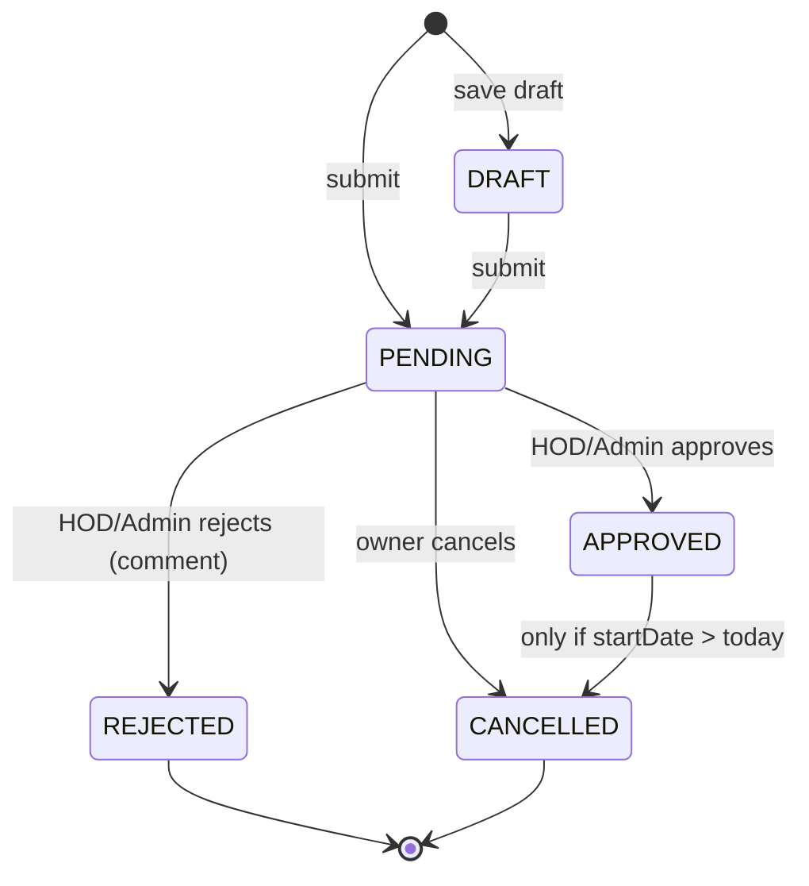
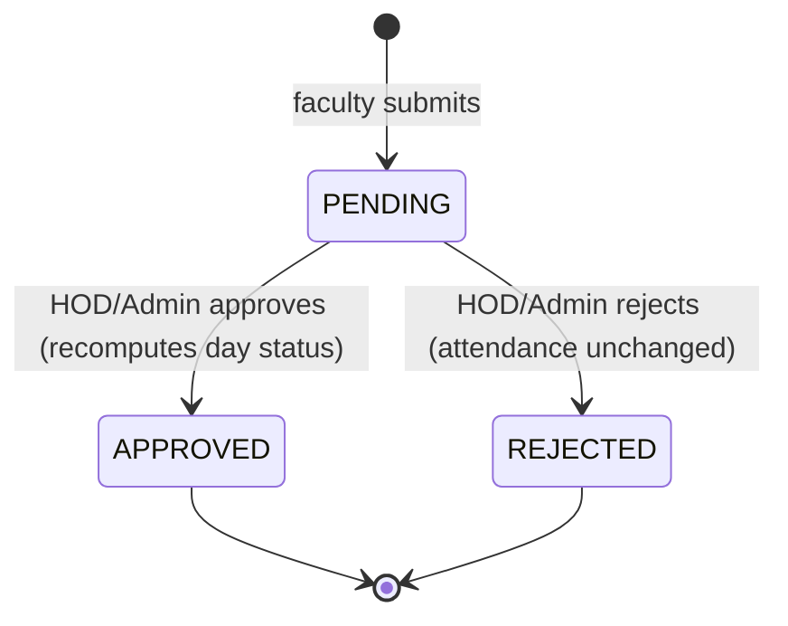
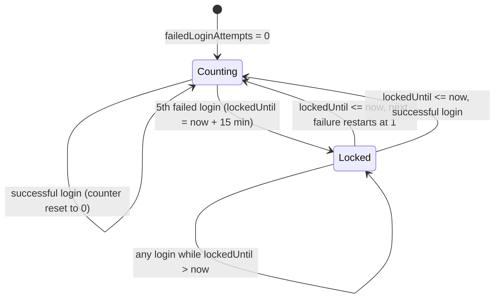
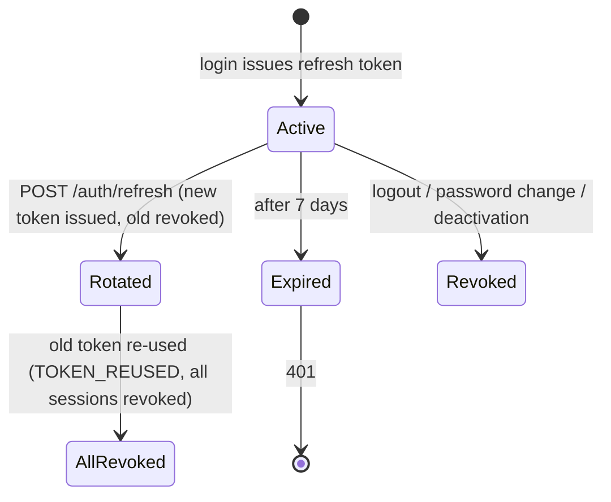

# State Transition Testing (ST)

All scenarios use **synthetic demo data**. Sources: `canTransitionLeave` (`leaveRules.ts`), `regularizationService.review`, `lockout.ts`, `authService.refresh`.

## ST-1 Leave request state machine (REQ-LEAVE-04, REQ-LEAVE-06)

Guard: `APPROVED -> CANCELLED` is refused when `startDate <= today` ("Approved leave can be cancelled only before it starts"). Cancelling an approved future leave restores the balance. Disallowed transitions are refused (HTTP 409 at the API).

### Full 5x5 transition table (today 2026-03-02; guard rows use a future start 2026-03-09 unless stated)

| # | From | To | Valid? | Notes |
|---|---|---|---|---|
| 1 | DRAFT | DRAFT | invalid | |
| 2 | DRAFT | PENDING | valid | submit |
| 3 | DRAFT | APPROVED | invalid | |
| 4 | DRAFT | REJECTED | invalid | |
| 5 | DRAFT | CANCELLED | invalid | |
| 6 | PENDING | DRAFT | invalid | |
| 7 | PENDING | PENDING | invalid | |
| 8 | PENDING | APPROVED | valid | |
| 9 | PENDING | REJECTED | valid | |
| 10 | PENDING | CANCELLED | valid | |
| 11 | APPROVED | DRAFT | invalid | |
| 12 | APPROVED | PENDING | invalid | |
| 13 | APPROVED | APPROVED | invalid | |
| 14 | APPROVED | REJECTED | invalid | |
| 15a | APPROVED | CANCELLED (start 2026-03-09, future) | valid | guard satisfied |
| 15b | APPROVED | CANCELLED (start 2026-03-02, today) | invalid | guard fails |
| 15c | APPROVED | CANCELLED (start 2026-03-01, past) | invalid | guard fails |
| 16 | REJECTED | DRAFT / PENDING / APPROVED / REJECTED / CANCELLED | invalid (5 transitions) | terminal |
| 17 | CANCELLED | DRAFT / PENDING / APPROVED / REJECTED / CANCELLED | invalid (5 transitions) | terminal |

Counting the 25 ordered pairs: 5 valid (DRAFT-PENDING, PENDING-APPROVED, PENDING-REJECTED, PENDING-CANCELLED, APPROVED-CANCELLED) and 20 invalid.

### Transition coverage table

| Transition | Covered by test case | Level |
|---|---|---|
| DRAFT -> PENDING | TC-LEAVE-022 | U, I |
| PENDING -> APPROVED | TC-LEAVE-023, TC-LEAVE-036 | U, I |
| PENDING -> REJECTED | TC-LEAVE-024 | U, I |
| PENDING -> CANCELLED | TC-LEAVE-025 | U |
| APPROVED -> CANCELLED (future) | TC-LEAVE-026, TC-LEAVE-040 | U, I |
| APPROVED -> CANCELLED (starts today) | TC-LEAVE-027 | U |
| APPROVED -> CANCELLED (already started, API) | TC-LEAVE-028 | I |
| all 20 invalid pairs | TC-LEAVE-029 (data-driven over the 20 pairs) | U |
| REJECTED / CANCELLED to anything | TC-LEAVE-030, TC-LEAVE-031 | U |

## ST-2 Regularization request status (REQ-REG-03)

| From | To | Valid? | Result |
|---|---|---|---|
| PENDING | APPROVED | valid | 200; attendance recomputed; audit correction |
| PENDING | REJECTED | valid | 200; attendance unchanged |
| APPROVED | APPROVED / REJECTED | invalid | 409 INVALID_TRANSITION "already approved" |
| REJECTED | APPROVED / REJECTED | invalid | 409 INVALID_TRANSITION "already rejected" |

Coverage: PENDING->APPROVED TC-REG-012, PENDING->REJECTED TC-REG-013, terminal states TC-REG-015.

## ST-3 Account lockout (REQ-AUTH-05)

| State | Event | Next state | Test case |
|---|---|---|---|
| Counting (0) | wrong password | Counting (1) | TC-AUTH-017 |
| Counting (4) | wrong password | Locked, 15 min | TC-AUTH-018 |
| Locked | login (even correct) before expiry | Locked | TC-AUTH-019 |
| Locked | time reaches lockedUntil | unlocked | TC-AUTH-020 |
| Counting (n) | successful login | Counting (0) | TC-AUTH-021 |

## ST-4 Refresh-token rotation (REQ-AUTH-02)

| State | Event | Result | Test case |
|---|---|---|---|
| Active | refresh | 200, new token; old token marked rotated | TC-AUTH-006 |
| Rotated | refresh with old token | 401 TOKEN_REUSED; every session of the user revoked | TC-AUTH-007 |
| Active (expired) | refresh | 401 | TC-AUTH-008 |
| unknown / missing | refresh | 401 INVALID_TOKEN | TC-AUTH-008 |
