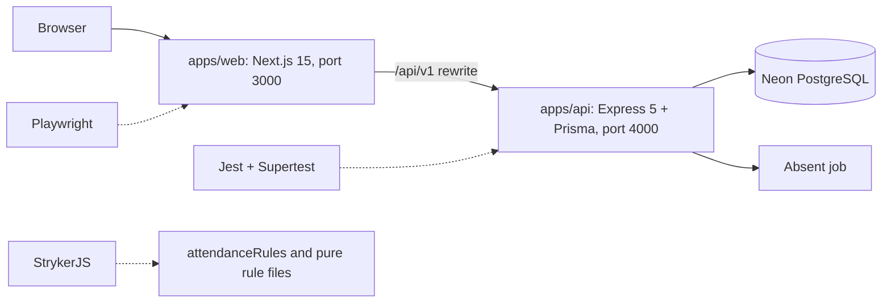

# Faculty Attendance Management System (FAMS) — Software Testing Portfolio

    

Badges are static labels; real numbers live in [06 Test Reports](06_Test_Reports).

**Subject:** Software Testing  
**Team:** _Name(s), roll number(s), class, section — to be filled_

## Objectives
Build FAMS (Next.js + Express + Prisma on Neon PostgreSQL) and a full testing portfolio around it: test plan, test design techniques (EP, BVA, decision tables, state transition), defect reports, Jest/Supertest, Playwright and StrykerJS mutation testing.

## Setup
1. Copy `.env.example` to `apps/api/.env` and paste your Neon URLs.
2. `npm install`
3. `npm run db:migrate && npm run db:seed`
4. `npm run dev`

## Architecture

## Scripts
| Command | What it does |
|---|---|
| `npm run dev` | API dev server |
| `npm run dev --workspace apps/web` | Web dev server |
| `npm test` | Jest with coverage (API) |
| `npm run test:e2e` | Playwright (needs API and web running or startable) |
| `npm run screenshots` | Screenshots into `07_Screenshots` |
| `npm run test:mutation` | StrykerJS on pure rule files |
| `npm run build` / `lint` / `typecheck` | All workspaces |

See [DEMO_SCRIPT.md](DEMO_SCRIPT.md) for a walkthrough.

## Portfolio
[01 Test Plan](01_Test_Plan) · [02 Test Case Design](02_Test_Case_Design) · [03 Execution](03_Test_Execution) · [04 Defects](04_Defect_Reports) · [05 Automation](05_Test_Automation) · [06 Reports](06_Test_Reports) · [07 Screenshots](07_Screenshots)

## Demo credentials (synthetic seed data)
| Role | Email | Password |
|---|---|---|
| Admin | `admin@fams.test` | `Demo@1234` |
| HOD (CSE) | `hod.cse@fams.test` | `Demo@1234` |
| Faculty (CSE) | `cse.faculty1@fams.test` | `Demo@1234` |

Seed: 1 admin, 4 departments (CSE, ECE, MECH, CIVIL), 4 HODs, 40 faculty, 90 days of attendance, 7 holidays, leave requests in every state.
